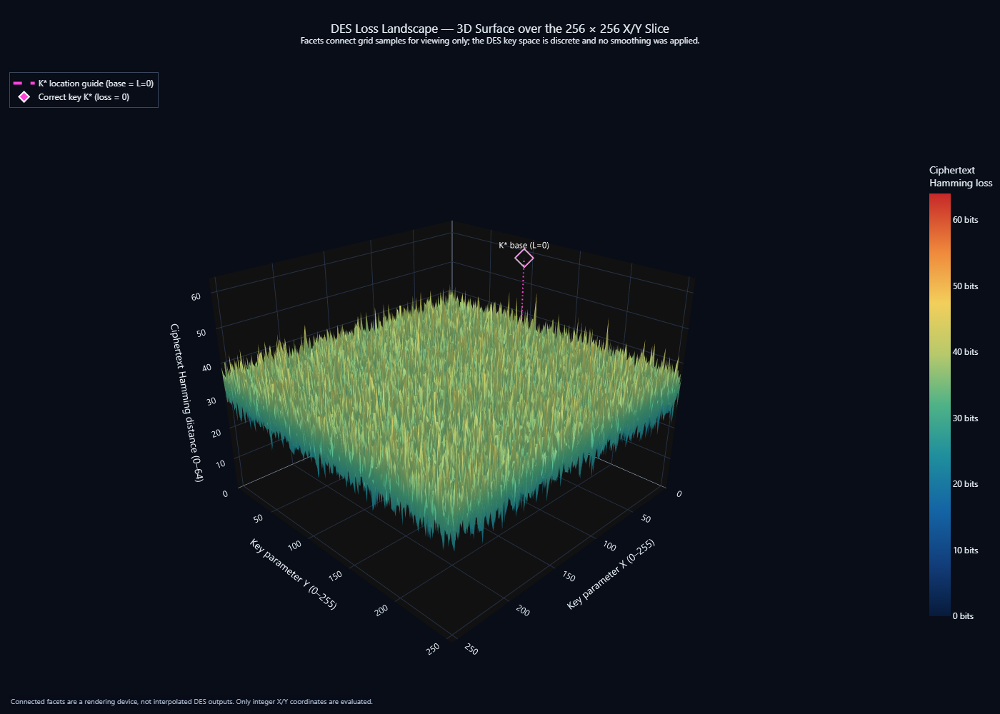
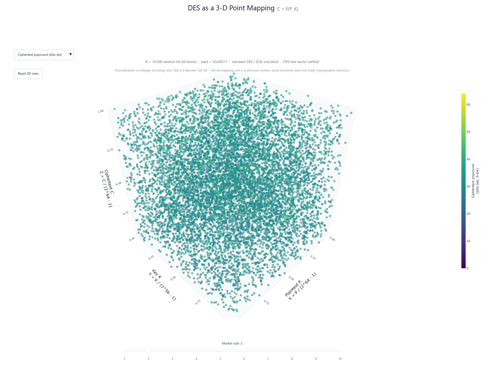
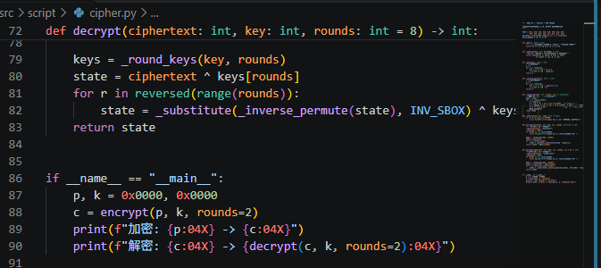
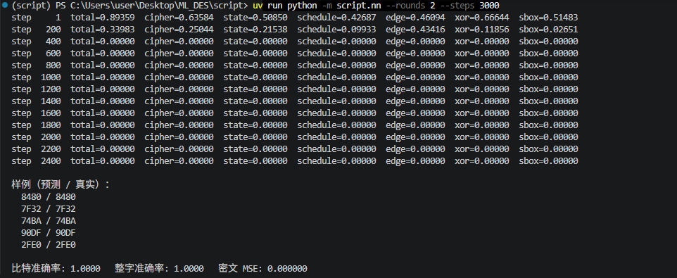
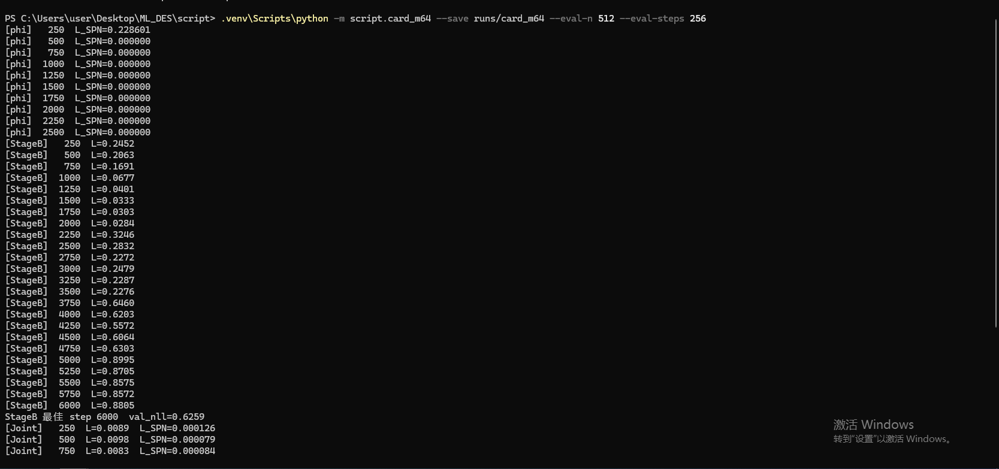
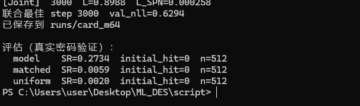

[TOC]

# 前言

之前和老师讲述了用机器学习预测密钥来破解des的思路，根据实验发现不行。

# 分析原因

des整个就是一个不可导的函数，根本没有可以学习的梯度。但是我还是觉得我的方向有搞头，假设固定了一个密钥，它能生成无穷多个明文密文对，明文密文对里面一定是有某种重复的部分，一定是包含了某种重复特征的不然固定有限的密钥无法无限的明文密文对的某种信息。所以我们需要某种方法找到一些特征的规律。

# 不可导的处理

因为不可导所以没有梯度，没有梯度则无法让神经网络学习。那我们换一个思路呢？例如SVM中有提到一种叫做kernel trick的技巧，将低维的信息视作高维的投影，在高维中进行计算，最终在投影回去低维，以此完成分类任务。

那我们能不能这样子思考？也许des加密过程就是某一个高维空间中的投影呢？也许我们能找到高维空间中某一个光滑可导的函数，让神经网络在高维中学习，然后再投影到低维呢？于是我找到了流形相关的知识，但是我觉得不适合我的场景。

最终还是回到了神经网络，因为神经网络本身也是高维空间中的某种东西，神经网络的最后一层实际上就是高维投影到低维的过程。

# DES可视化

## loss可视化

固定了密文和密钥，xy轴是生成候选密钥的参数，z轴是候选密钥和真实密钥的loss，可以看到高低起伏密密麻麻的，根本无法找到一个可以学习的梯度，就算学"会"了可能也是陷入到一个小坑中。

## 密钥-明文-密文可视化

输入是密钥和明文输出是密文，然后也绘制可视化图表，同样也是杂乱无章没有规律的，完完全全是不可导的。

# 构造高维空间中的函数

我依然采用神经网络去构造高维神经网络去模拟整个des的加密过程，但是没有意义，肯定是能模拟出来的。但是模拟出来的不意味着梯度有相同的含义，真正需要思考的是"在训练阶段，怎样设计一种损失函数，让网络学到的梯度不仅有利于预测密文，还能在未见过的目标密钥上指导搜索"?

首先，我们需要让神经网络理解整个加密的过程，那么就不能直接把des的明文密钥和密文进行训练。而是要拆开，把des的每一步单独用一个小模型去模拟，损失函数就是每一个小模型的loss和最终多个小模型组合起来的预测的密文的loss。这样子整体的神经网络就能理解des的原理了。并且这样子在高维空间中得到的函数一定是可导的，因为神经网络是可导的。

后面我仔细的思考了一下，如果只有密文，信息是不足够恢复出密钥的，因为密文中的一部分信息在密钥里面，这一部分信息不能凭空出现。于是乎转向两种场景的神经网络神经，第一个是**已知明文攻击**的场景，第二个是**多样本唯密文密钥恢复**的场景。

# 已知明文攻击的神经网络设计

为了找到这个`高维函数`我想使用神经网络模拟，同时不仅仅只是模拟，运行的过程也要和真实的des有相同的含义，否则单纯的模拟没有意义。这是使用的是简化后的2轮Feistel 结构的加密算法。

我们假设存在这样的一个高维函数F，这个函数投影到低维后能完美的对应des加密的所有过程。并且这个高维函数F的可导可微连续的。通过对高维函数F的梯度计算，能够让我们得到投影后的信息

## 梯度监督

如果将神经网络训练的过程种，损失函数在加一个"梯度"项呢，让训练的时候"梯度"也相似。但是密码算法是离散的，没有梯度的概念，于是我人为定义成，其他输入不变下，反转密钥的某一个比特，计算反转前后密文的距离，这样子定义离散的梯度。

## 简化的Feistel 密码设计

接收两个16位的二进制数：

明文 \(P\)和密钥 \(K\)

最后输出一个16位密文：
$$
C=E_R(P,K)
$$
这里的 \(R\) 是加密轮数，可以是2轮、4轮、6轮或8轮。

### SBOX

| 输入（16进制） | 输出（16进制） |
| -------------- | -------------- |
| 0              | C              |
| 1              | 5              |
| 2              | 6              |
| 3              | B              |
| 4              | 9              |
| 5              | 0              |
| 6              | A              |
| 7              | D              |
| 8              | 3              |
| 9              | E              |
| A              | F              |
| B              | 8              |
| C              | 4              |
| D              | 7              |
| E              | 1              |
| F              | 2              |

### PBOX

$$
 p(i)= \begin{cases} 4i\bmod15,&i<15\\ 15,&i=15 \end{cases} 
$$

实验最简单的方式进行置换

### 轮密钥编排函数g

$$
k_R=g_{R-1}(k_{R-1})
$$
其中$k_0=K$

生成下一轮密钥需要执行三个操作：

1. 把16位轮密钥循环左移5位。
2. 对最高4位执行S盒代换。
3. 对最低4位异或轮常数 \(r+1\)（取低4位）。

### 计算示例

输入：
$$
 P=0000_{\mathrm{hex}} 

 K=0000_{\mathrm{hex}} 
$$
其中下标hex表示十六进制。

#### 第一轮

初始状态和密钥：
$$
 x_0=0000,\qquad k_0=0000 
$$
第一步，异或密钥：
$$
 0000\oplus0000=0000 
$$
第二步，S盒代换：
$$
 0000\rightarrow CCCC 
$$
第三步，P盒置换：
$$
CCCC\rightarrow FF00 
$$
与此同时，生成下一轮密钥：
$$
 k_1=C001 
$$
第一轮结束：
$$
x_1=FF00
$$

#### 第二轮

第二轮开始：
$$
 x_1=FF00,\qquad k_1=C001 
$$
异或：
$$
 FF00\oplus C001=3F01 
$$
S盒代换：
$$
3F01\rightarrow B2C5 
$$
P盒置换：
$$
 B2C5\rightarrow A3C9 
$$
同时生成最终轮密钥：
$$
k_2=C03A 
$$
第二轮结束：
$$
x_2=A3C9
$$

#### 最后一步

$$
 C=x_2\oplus k_2 \\

 A3C9\oplus C03A=63F3 
$$

最终就得到了密文为0x63F3

解密的过程就是逆着过来就行了。讲这个密码称为SPN

大概用了不到100行实现这个代码

## 密文预测模型

首先我们要找到所需要的高维函数，我其实想了很多各种各样的办法，也设计了各种各样的神经网络，最终还是我将要写的效果比较好。神经网络的中间状态实际上就是一个高维函数，而神经网络的最后一层实际上就是投影，所以我们可以尝试用神经网络的中间状态当作要找的高维函数，但是这个没有解决结果一致的运行过程可能不一致这个问题，先留下一个悬念后面会写如何处理这个问题。

$$
P\in\{0,1\}^{16},\qquad K_t\in\{0,1\}^{16}
$$
我们输入的是明文P和密钥K的每个bit，也就是两个16维的向量

$$
\hat v_0=\operatorname{XORNet}(P,\hat k_0)
$$
第一个子网络是XORNet，用于学习XOR的部分

$$
\hat w_0=\operatorname{SBoxNet}(\hat v_0)
$$
然后是复杂SBOX的子网络

$$
\hat x_1=\operatorname{PermNet}(\hat w_0)
$$
然后在P置换

$$
KeySchedule：复用XORNet、SBoxNet和固定布线
$$
KeySchedule计算下一轮密钥$\hat k_1$。用 \(\hat x_1\) 和 \(\hat k_1\) 继续计算$\hat x_2$

\[
\hat C=\operatorname{XORNet}(\hat x_2,\hat k_2)
\]
最终得到如上的密文

### 损失函数

$$
L_{\mathrm{XOR}}
=
\frac14
\sum_{(a,b)\in\{0,1\}^2}
\left(\operatorname{XORNet}(a,b)-(a\oplus b)\right)^2
$$

XORNet的损失函数

$$
L_{\mathrm{SBox}}
=
\frac1{16}
\sum_{x\in\{0,1\}^4}
\frac14
\|\operatorname{SBoxNet}(x)-S(x)\|_2^2
$$
SBox的损失函数

$$
L_{\mathrm{state}} = \frac1{16R} \sum_{r=1}^{R} \|\hat x_r-x_r\|_2^2 
$$
中间轮的损失函数

$$
L_{\mathrm{cipher}}
=
\ E_{P,K}
[
\frac1{16}
\|F_\phi(P,K)-E_R(P,K)\|_2^2
]
$$
最终密文的损失函数,这里的$\ E_{P,K}$是训练采样的样本求和然后取平均，例如本次训练采样了4个样本，计算每一个$[
\frac1{16}
\|F_\phi(P,K)-E_R(P,K)\|_2^2
]$,然后求和处于4，这种做法叫作mini-batch训练。实际深度学习往往使用32、64、128甚至更多样本组成一个batch，使梯度估计通常比单样本更稳定。

$$
L_{\mathrm{schedule}}
=
\frac1{16(R+1)}
\sum_{r=0}^{R}
\|\hat k_r-k_r\|_2^2
$$
密钥编排损失函数

$$
 K'=K\oplus e_i 
$$
真实密钥翻转一位

$$
 \Delta C=E_R(P,K')-E_R(P,K) 
$$
真实密文变化

$$
 \Delta\hat C=F_\phi(P,K')-F_\phi(P,K) 
$$
网络预测变化
$$
 L_{\mathrm{edge}} =  E_{P,K,i} [ \frac1{16}\|\Delta\hat C-\Delta C\|_2^2 ] 
$$
定义相邻密钥差分损失

$$
L_{\mathrm{SPN}}(\phi)
=L_{\mathrm{cipher}}
+\alpha L_{\mathrm{state}}
+\beta L_{\mathrm{schedule}}
+\gamma L_{\mathrm{edge}}
$$
最终得到总损失函数，这里的 \(\alpha,\beta,\gamma\) 是训练权重。

### 模型训练

然后就是使用pytorch训练了

这个是必然的，肯定没问题，轮数继续增加也没有问题

## 密钥预测网络

我们的核心思路是找到一个高维的函数，这个高维的函数低维投影后就是加密算法，我们在高维的网络中进行学习来预测。加上我们使用密文预测模型找到的就是我们理想中的那个高维函数，那这个高维函数要能指导我们对密钥进行预测，我思考了很多种乱七八糟的方案，最终的想法是，我们不需要直到第一个网络到底是不是我们所需要的高维函数，而是将它修正到是为止。

$$
H_B(P,K_t)= [\hat x_1,\hat x_2,\hat k_0,\hat k_1,\hat k_2]
$$
第二网络看到的80维，不是80位密钥，也不是80位密文，而是第一网络在使用当前候选密钥进行加密时产生的多个连续中间状态。

$$
C^*=E(P,K^*)
$$
需要其中$C^*$为目标密文，$K^*$为目标密钥

$$
r=F(P,K_t)-C^*
$$
然后计算预测的密文和真实的密文差距多少

$$
v=
[
P,\,
C^*,\,
\hat C,\,
r,\,
h
]
$$
组合成一个向量，第一网络高维特征 记作\(h\)。

$$
z=g(v)
$$
然后将v作为输入，输入到一个MLP中，输出一个16维度的向量。

### 多个明文密文对的情况

$$
\mathcal{D}=\{(P_j,C_j^*)\}_{j=1}^{m},\qquad C_j^*=E_R(P_j,K^*).
$$

已知 $m$ 对公开数据，全部由同一个目标密钥 $K^*$ 产生

候选密钥 $K_t$ 下，第一网络逐对给出

$$
\hat C_j=F_\phi(P_j,K_t),\qquad r_j=\hat C_j-C_j^*,\qquad h_j=H_B(P_j,K_t),
$$

$$
v_j=[\,P_j,\ C_j^*,\ \hat C_j,\ r_j,\ h_j\,].
$$

第二网络对每对独立编码后取平均（与 $m$ 无关的池化）：

$$
z=\frac1m\sum_{j=1}^{m} g(v_j),
$$

最终会输出两个头，第一个是基数头决定需要翻转几个，位头决定哪些位需要翻转。基数头是top-k，位头是输出每一位翻转的概率。

### 损失函数

$$
b=K_t\oplus K^*
$$

疑惑一下后，b的取值就是需要翻转的比特

$$
 L_{\mathrm{BCE}} = -\frac1{16} \sum_{i=0}^{15} [ b_i\log p_i+ (1-b_i)\log(1-p_i) ] 
$$
定义二进制交叉熵，这个损失让第二网络学会判断当前候选密钥的哪些位置与真实密钥不同。

$$
 L_{\mathrm{distance}} = \frac1{16}\sum_{i=0}^{15} [ b_i(1-p_i)+(1-b_i)p_i ] 
$$
我们还希望网络预测的翻转操作，能够让新密钥更接近真实密钥，更新后与真实密钥的期望汉明距离也作为损失，上面这个是**位头**的损失。

$$
b=K_t\oplus K^*\in\{0,1\}^{16},\qquad k_{\mathrm{true}}=\sum_{i=0}^{15}b_i=d(K_t,K^*)\in\{0,\dots,16\}.
$$
还要基数头，最终$k_{\mathrm{true}}$得到的就是需要翻转几个比特

$$
q=\operatorname{CardHead}(z)\in{R}^{17}
$$
基数头最终会给一个17维度的向量

$$
L_{\mathrm{card}}

=-\log\frac{\exp(q_{k_{\mathrm{true}}})}{\sum_{\kappa=0}^{16}\exp(q_\kappa)}
$$
然后再计算交叉熵，这里的$q_{k_{\mathrm{true}}}$代表的就算对应位数的值

$$
L_{\mathrm{second}} = L_{\mathrm{BCE}} + \lambda_dL_{\mathrm{distance}}+\lambda_k L_{\mathrm{card}}
$$
最终第二个网络的损失函数就为上面这个

## 联合训练

这样子设计最终的目标就算为了联合训练，我在本章开头留了一个悬念"结果一致的运行过程可能不一致这个问题"。我们需要的高维函数实际上就是能帮我们对预测密钥有帮助的，而联合训练中，第一个网络帮我们找到这样子的候选高维函数，第二个网络帮助我们接近就是我们需要的高维函数，两个联合训练最终就是我们需要的结果。

$$
L_{\mathrm{joint}}
=
L_{\mathrm{cipher}}
+\alpha L_{\mathrm{state}}
+\beta L_{\mathrm{schedule}}
+\gamma L_{\mathrm{edge}}
+ L_{\mathrm{BCE}} + \lambda_dL_{\mathrm{distance}}+\lambda_k L_{\mathrm{card}}
$$
这个就是最终的联合训练损失函数，训练的过程中就会不断的调整两个模型的参数了。

## 训练过程

### 阶段 1：训练第一网络 φ

每个 step：

1. 从训练划分抽 128 个 $(P,K)$（不涉及 $K^*$）；
2. 前向 $\hat C,\hat x_r,\hat k_r$；
3. 最小化
   $$L_{\mathrm{SPN}}=L_{\mathrm{cipher}}+\alpha L_{\mathrm{state}}+\beta L_{\mathrm{schedule}}+\gamma L_{\mathrm{edge}};$$
4. Adam，lr $10^{-3}$，余弦退火，2500 步。训练后 $F_\phi$ 在全部二进制输入上等于 $E_R$。

### 阶段 2：冻结 φ，训练第二网络 ψ

每个 step：

1. 从训练划分抽 $B=256$ 个目标密钥 $K^*$；
2. 按课程抽候选 $K_t$：$d\in\{1\}\to\{1,2\}\to\{1,2,4\}\to$ 全距离（混入 50% 随机密钥）；
3. 为每个任务抽 $m=64$ 个明文，构造 $C_j^*=E_R(P_j,K^*)$（**同一个 $K^*$**，运行时断言校验）；
4. 冻结 φ 前向：$\hat C_j=F_\phi(P_j,K_t)$，$h_j=H_B(P_j,K_t)$，$v_j=[P_j,C_j^*,\hat C_j,\hat C_j-C_j^*,h_j]$；
5. ψ 前向：$z=\frac1m\sum_j g(v_j)$，$s=\mathrm{Head}([z,K_t])$，$q=\mathrm{CardHead}(z)$；
6. 计算
   $$L_{\mathrm{second}}=L_{\mathrm{BCE}}+\lambda_dL_{\mathrm{distance}}+\lambda_kL_{\mathrm{card}};$$
7. 只更新 ψ；Adam，lr $10^{-3}$，余弦退火，6000 步；每 250 步在验证集算 NLL，保留最佳 checkpoint。

### 阶段 3：联合训练

1. 解冻 φ（lr $10^{-4}$，ψ 仍 $10^{-3}$）；
2. 同样的 batch 与课程，最小化
   $$L_{\mathrm{joint}}=L_{\mathrm{SPN}}(\phi)+L_{\mathrm{second}}(\phi,\psi);$$
3. 一次反向传播同时更新两个网络；
4. 每 50 步记录 $|\nabla_\phi L_{\mathrm{second}}|$：联合时非零，冻结对照严格为零；
5. 3000 步，余弦退火；验证集 NLL 选择最佳 checkpoint。

### 推理/攻击

从随机 $K_0$ 开始，重复"前向 → 解码 → 验证"：

$$
p=\sigma(s),\quad \hat k=\arg\max q,\quad M=\text{top-}\hat k(p),\quad K_{t+1}=K_t\oplus M,
$$

直到 $E_R(P_j,K_{t+1})=C_j^*\ (\forall j)$ 或达到候选预算。成功判定只用真实密码重加密。

## 效果

2轮的密码比较简单，状态空间也比较小密钥和密文的状态空间都只有65535，密文密钥对的状态空间是$2^{32}$次方大约42亿。训练过程中的样本是远远小于42亿的。

然后就开始训练了

拿训练好的模型取搜索密钥matched成功率约为27%，uniform为完全随机成功率不足%1，matched是只保留基数头的成功率。

这个模型在这个简化了2轮feistel,是真正学习到了一些东西的。但是一旦上升到4轮，模型就没有办法学习了，我认为这种方式在已知明文攻击的场景还是有一些突破的可能性的。

# 总结

整个过程思考了很多中神经网络设计方案，更换了很多种距离和损失函数，是从众多结构中挑选出来学习效果最好的一个，这个过程我发现有时候其实改几个数字对学习的影响是巨大的。

我觉得上面这个实验还是能说明一些问题，目前还在思考为什么4轮就不行了，应该需要继续调整参数和架构，**我觉得肯定是存在这样子的一个高维函数，只是我们找不到，但是可以用神经网络去逼近它，于是如何设计损失函数就变得至关重要**。
